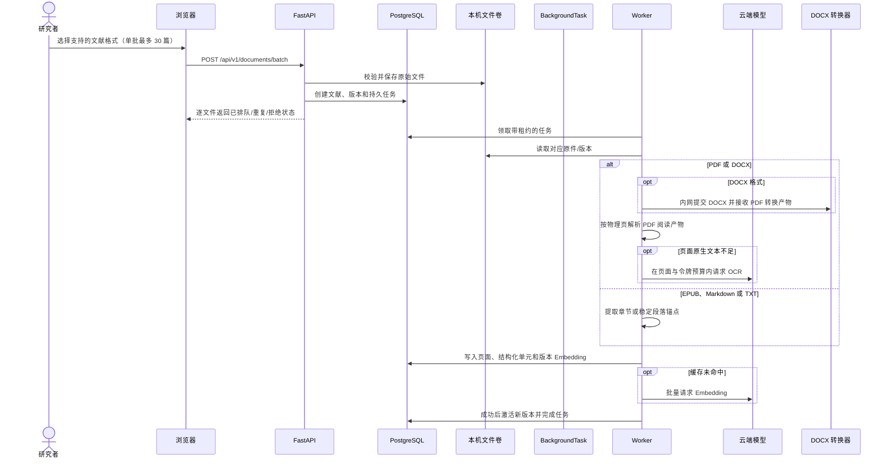
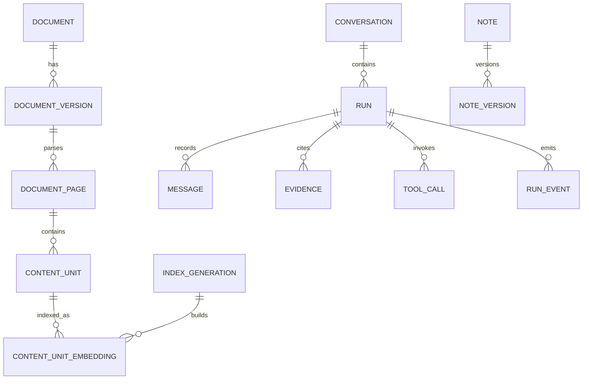

# 系统架构与关键流程

本文依据当前仓库实现整理，用于毕设技术说明。系统面向单用户本地运行：浏览器与 API、任务 worker、PostgreSQL 由 Docker Compose 编排；需要模型能力时，API 或 worker 请求云端推理服务。原始文献、转换产物、数据库和索引保存在本地 Docker 数据卷。当前产品以文献库、阅读器、全局助手和独立笔记为主流程，不再通过专题组织新对话。

## 组件

| 组件 | 实现 | 职责 |
|---|---|---|
| Web 界面 | Vue 3、TypeScript、Vite | 文献库、PDF/EPUB/DOCX/文本阅读器、全局助手和独立笔记 |
| HTTP API | FastAPI | 文献版本、独立会话/笔记、研究任务、引用及阅读位置接口 |
| 后台 worker | Python 进程 | 多格式解析、OCR/Embedding、索引构建和研究任务执行 |
| 数据库 | PostgreSQL 17 + pgvector | 结构化状态、任务队列、文本单元、向量、事件、笔记版本及历史成果 |
| 文件卷 | Docker 命名卷 | 保存原始文献及派生阅读文件 |
| DOCX 转换器 | 生产版内部 sidecar | 将 DOCX 转成 PDF；不挂载文献卷、不提供外部端口或模型凭据 |
| 云端模型 | SiliconFlow API | OCR、Embedding、Reranker 和研究 Agent 模型调用 |

前端不接收模型 Key。Compose 只将 `SILICONFLOW_API_KEY` 注入 API 和 worker。开发 Compose 默认将前端、API、PostgreSQL 绑定到 `127.0.0.1:5174`、`127.0.0.1:8002`、`127.0.0.1:5432`；产品 Compose 只向宿主机发布 `127.0.0.1:5174`，API、数据库和 DOCX 转换器仅供内部网络通信。

## 文献导入和索引

API 对每个文件独立返回结果；按内容 SHA-256 做重复识别。解析任务由数据库队列持久保存。解析得到物理页、文本/图表/表格/公式内容单元及检索字段；页面原生文字少于阈值时可走 OCR。派生识别结果可用于检索和定位，但不会自动升级为可逐字引用的原文。

## 检索

查询向量先在模型/维度/内容哈希构成的缓存键下查找。当前混合检索从活动索引代查询：半精度 HNSW 向量召回最多 30 个单元，全文检索最多 30 个单元，随后使用 Reciprocal Rank Fusion 合并至最多 40 个候选。R3 将候选送入 Reranker，结果聚合为最多 8 个唯一物理页。业务接口的范围过滤同时约束文献和版本。

索引代记录 Embedding 模型、维度和配置哈希。新代重建完成后才切换活动状态；研究任务将所用索引代写入范围快照，确保任务过程中的检索来源可复现。

## 全局助手、范围、上下文和事件

当前助手的会话独立于专题。新运行采用 scope v2，可选择全库或限定文献集合；后端冻结文献版本和索引代并计算范围快照哈希，工具调用会再次验证该快照及引用是否仍在范围内。旧会话的专题范围快照保持原样，并继续按旧范围校验。历史专题、记忆、成果及其版本不删除，但不属于当前导航主流程；旧专题/成果深链会跳转到文献库。

每轮提问还固定 `page_context`：页面类型、可选文献及版本、格式化 locator、选区和当前笔记 revision。PDF/DOCX 阅读产物用物理页，EPUB 用章节与可选 CFI，Markdown/纯文本用稳定段落锚点。它只帮助工具理解用户位置，不替代后端对文献范围、版本和证据的验证。Agent 页面操作限定为打开文献/位置、展示候选或聚焦笔记，带稳定 action id；刷新和历史重放不会自动重复执行。模糊文献匹配由用户从候选列表选择。

笔记是独立的版本化对象。编辑器 JSON 经过允许列表校验；草稿先写入浏览器本地存储，再按 revision 自动同步。服务端版本为权威，更新采用 CAS；冲突保留本地草稿。AI 改写只创建基于指定 revision 的候选，用户可以查看前后内容，确认后才将候选采纳为当前版本。

研究任务、消息、工具调用和事件都持久化。事件流支持 `Last-Event-ID` 重放；游标失效时返回完整任务快照。每个任务保留最多 256 条事件，长期答案和状态可由 REST 快照读取。

## 可靠性与安全边界

- 后台任务使用数据库租约和递增 fencing token；worker 定期续租。旧租约失效后，旧 worker 不能提交索引、证据或任务终态。
- 文献替换先准备新版本，成功后再切换；失败版本不取代当前可读版本。
- 取消会阻止未开始的云端请求以及响应返回后的后续工具和成果副作用。同步 HTTP 请求已经发出后，系统不能强制终止供应商侧计算。
- DOCX 原件始终保留，阅读器展示 LibreOffice 转换的 PDF 产物。复杂字体、分页、页眉页脚或对象排版可能与 Word 存在差异；页面引用定位的是转换版页码。
- 文件和数据库位于本机卷，模型请求的数据会离开本机。用户应仅提交有权处理的资料，并将 `.env` 和数据卷视为敏感内容。
- 当前为单用户本机服务，没有登录认证。来源校验用于限制跨站写请求，不代替认证；不要将监听端口映射到公网。

## 范围限制

现有四篇论文的导入和候选问答用于验证工程链路，不代表 100 篇真实论文规模验收。B2 多格式阅读、全局范围、页面上下文、导航、取消和笔记候选采纳仍待主流程浏览器验收；百篇真实语料验收尚未完成。视觉/OCR 结果、图表区域定位、学术答案质量及检索指标仍受样本和人工复核状态限制。详见[评测方案与当前证据](../evaluation/评测方案与当前证据.md)。
